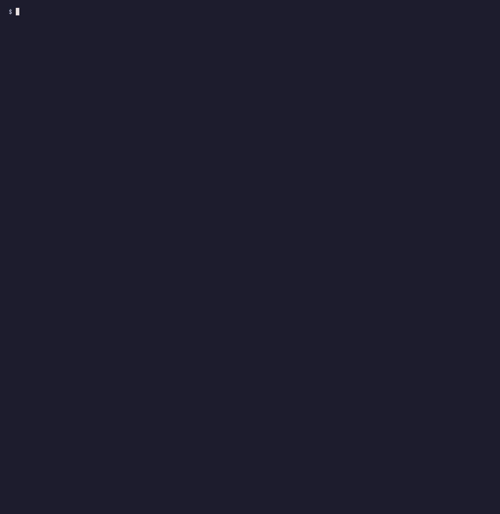
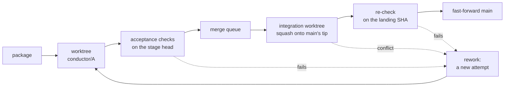

# aura-conductor

[](https://github.com/mrtreyw07-lab/aura-conductor/actions/workflows/ci.yml)

A landing engine for parallel coding agents: each package of work gets its own git worktree, and main only ever
fast-forwards to a commit whose checks passed on that exact commit.



## The problem

Parallel agents break main. Two agents start from the same commit and edit the same file, and the second one to land
undoes the first. An agent's tests pass against a main that has moved on by the time its work lands. Someone rebases
to tidy up, and the commits a review pointed at no longer exist. Afterwards nobody can say which commit was checked,
by what, or when.

conductor is the part of an orchestrator that decides what reaches main. It doesn't write code, as that is the
agents' job. It gives each package its own worktree, holds it to the files it declared, runs its acceptance checks,
and lands packages one at a time through a merge queue that re-runs the checks on the commit it is about to
fast-forward to.

## How it works



1. A workflow file lists the packages. Each one names the files it may change, the agent that does the work, the
   checks that decide whether it lands, a verification tier, and the packages it depends on. A package starts only
   after everything it depends on has landed, so it starts from a tip that already has them.
2. Each package runs in `.conductor/worktrees/<id>` on branch `conductor/<id>`. The agent changes files; conductor
   commits the stage and refuses it if anything outside the package's declared files changed.
3. Before its checks the branch is refreshed by merging main into it, never by a rebase, as the stage commits are
   the receipts. The checks must pass on that head and leave the tree as they found it. From tier T1 a reviewer
   agent reads the change, and at T3 the approver decides before it can land.
4. The merge queue lands one package at a time. It squashes the branch onto main's tip in a separate integration
   worktree, runs the checks again on that commit, and fast-forwards main to it. A conflict in the queue or refresh
   starts a new attempt from the current tip. A failed check, review or re-check continues in the same worktree
   as a new attempt; the branch is refreshed before verification.

[docs/architecture.md](docs/architecture.md) has the module map, the state machine and the on-disk layout.

## Guarantees

Each of these has a test.

- **Main only fast-forwards.** `git merge --ff-only` in your checkout, or `git update-ref main <landing> <parent>`
  when main is checked out nowhere. Neither moves main unless it is exactly where the landing was built.
- **What lands is what was checked.** The landing is built from the exact head the package's checks, review and
  approval saw; if the branch moved after that, nothing lands and the package is reworked. The checks run again on the
  landing commit, on a clean tree that is looked at again after every check, and the receipt must show that commit as
  HEAD throughout and the exact check contract. Tracked paths with assume-unchanged or skip-worktree flags are refused
  before checks and after every command. If main moved in the meantime, the landing is built and checked again.
- **One landing at a time, per repository and across processes.** Creating, driving and cancelling a run take the
  repository's lock (`.conductor/conductor.lock`); a second process is refused and told who holds it.
- **Nothing is rebased or pushed.** `tests/test_guarantees.py` reads every git command the source builds, and
  `--force` appears only where conductor removes or resets its own worktrees.
- **A package lands only the files it declared.** Verification checks the saved implement head, any recorded refresh,
  and scope again on Resume. Unexpected commits are kept as discarded evidence, reset and reworked.
- **One unfinished run owns a package.** A second run with the same package id is refused until the first finishes or
  is cancelled, and cancelling a run removes only the worktrees it made.
- **A dependent package starts only after its dependencies land.**
- **Your checkout is never overwritten.** Staged changes, uncommitted edits or untracked files in a landing's way hold
  the landing. Nothing is touched, and it retries when your checkout changes, including when the file in the way is
  moved or deleted, an obstructing ancestor is cleared, or `index.lock` is removed. Refusals without a known cause
  also retry periodically while `--hold-wait` lasts.
- **Stage commits stay reachable.** Landed packages keep theirs under `refs/conductor/receipts/<id>/`, an earlier
  attempt's branch is renamed (`conductor/C@attempt-1`) rather than reset, and a stage discarded for leaving its scope
  keeps its commit under `refs/conductor/discarded/<id>/` and its patch as a receipt, including after a post-commit crash.
- **Stop holds, Resume continues the same attempt.** Implement work is kept. A cancelled check is restored to its
  clean starting head with cleanup evidence in its receipt. Claude session ids are saved before dispatch, and a
  Claude stopped before it saved its session starts again under the same id; other adapters resume when they
  supplied an id. A fresh worktree is replaced only once per run and attempt, so a crash
  after provisioning keeps that attempt's partial work. A reviewer that changed the tree still fails the attempt.
- **Agents and checks start from an allow-listed environment.** A child inherits only `PATH`, `HOME`, the temporary
  directory, the locale and the system variables Windows needs, plus names its workflow adds. Secret-shaped names
  (`*_TOKEN`, `*_KEY`, `*_SECRET`, `*_PASSWORD`, `*_JWT`, `*_DSN`, `*ASKPASS`, `GIT_CONFIG_*`, `SSH_AUTH_SOCK`, ...)
  are dropped even when a workflow lists them; only an adapter's `env_allow` passes one, by name. An AST guard fails
  the build on any spawn without an explicit `env=`. This covers the environment only: an agent that is not
  sandboxed still runs as you, so `HOME`, `~/.ssh`, git's credential helpers and its own CLI's login stay reachable.
- **Nothing runs outside a granted folder, or without an approval bound to the plan's fingerprint.** Resumed stages
  prove the worktree's canonical path and repository ownership again. Grant restoration reads projects and grants
  under the same records lock.
- **Complete events keep their sequence numbers.** Recovery adds a missing final newline to a complete record,
  drops only a torn tail and allocates above the highest sequence, even if earlier numbers are missing.

## Quickstart

Python 3.11 or newer and git 2.36 or newer. No API keys. CI runs the full suite on Linux (Python 3.11, 3.12 and 3.13) and
the unit tests and the demo on Windows; macOS should work but is not tested.

```bash
git clone https://github.com/mrtreyw07-lab/aura-conductor
cd aura-conductor
python -m venv .venv
source .venv/bin/activate        # on Windows: .venv\Scripts\activate
pip install -e .
conductor demo
```

The demo builds a throwaway repository from [examples/two-dependent-packages](examples/two-dependent-packages) and
runs three scripted packages. A and C start at once in their own worktrees. B depends on A and waits until A lands.
C appends to the same README lines as A, so once A lands, C no longer squashes onto main and goes back as rework.
Half-way through B's work the demo stops the run, shows the held state, and resumes it: B continues its first
attempt, and all three land. Add `--dir <folder>` to keep the repository and look around with `conductor status`,
`conductor log` and `git log`.

On your own repository:

```bash
cd your-repo
conductor grant .                  # once: you approve conductor working in this repository
conductor validate workflow.toml   # checks the file and warns about packages that may collide
conductor run workflow.toml        # you approve the plan, then it runs
```

`conductor stop` (from any terminal) or Ctrl+C holds the run, and `conductor resume` continues it.
`conductor log --follow` tails the events; `conductor cancel` ends a run for good.

## Writing a workflow file

```toml
version = 1
name = "greeter"
integration_branch = "main"
max_parallel = 2

[[packages]]
id = "A"
title = "Greeting module"
instruction = "Add greeter/greeting.py with greet(name), and its test."
files = ["greeter/greeting.py", "tests/test_greeting.py"]   # what this package may change; dirs end in /
verification_tier = "T0"                                     # T0 checks, T1 + review, T2 + other-family review, T3 + approval
max_attempts = 2

[packages.agent]
adapter = "scripted"
steps = [{ write = "greeter/greeting.py", content = "def greet(name):\n    return f'Hello, {name}!'\n" }]

[packages.acceptance]
checks = [{ argv = ["{python}", "-m", "unittest"], timeout_seconds = 120 }]   # argv lists, never a shell

[[packages]]
id = "B"
title = "Command-line entry point"
depends_on = ["A"]
# ...
```

| Field | Meaning |
|---|---|
| `id` | Letters, digits, `_`, `.` and `-`; compared without case. No `..`, no `.lock` ending, no Windows device name (`CON`, `NUL`, ...): it names a directory and a branch. |
| `files` | The files and directories (ending in `/`) the package may change. Required. |
| `depends_on` | Packages that must land first. |
| `verification_tier` | `T0` checks only; `T1` adds a `reviewer`; `T2` needs a reviewer from another model family; `T3` also needs the approver's yes before landing. |
| `acceptance.checks` | Commands that decide whether the package lands, run in order. `{python}` is the interpreter conductor runs on. |
| `max_attempts` | Attempts before the package's budget is spent (1 to 5, default 2). |
| `timeout_seconds` | Per stage (default 1800). |
| `environment.link`, `.setup`, `.env` | Optional, top level: ignored directories to symlink into each worktree (`.venv`, `node_modules`), setup commands, and extra environment variables the checks and setup may see (secret-shaped names stay dropped). |
| `git.author_name`, `git.author_email` | Optional identity for conductor's commits. By default the repository's own. |

Unknown fields are refused, so a typo cannot silently drop a check. `integration_branch` (default `main`) must be a
local branch outside `conductor/`, which is where package branches live.

## Agent adapters

An adapter receives one stage of one package and changes files in its worktree. It never commits, pushes or lands.

| Adapter | What it runs | Implement | Review |
|---|---|---|---|
| `scripted` | A script of writes, appends, sleeps and failures, per attempt. The demo and the tests use it. | | |
| `codex_cli` | `codex exec --json`, the brief on stdin | `sandbox_mode="workspace-write"` | `sandbox_mode="read-only"` |
| `claude_code` | `claude -p --output-format json`, the brief on stdin | `--permission-mode acceptEdits` | `--permission-mode plan` |

```toml
[packages.agent]
adapter = "claude_code"
model = "claude-sonnet-5-5"                          # optional; the CLI's default otherwise
extra_args = ["--allowedTools", "Bash(pytest:*)"]    # let it run the tests while it works
env_allow = []                                       # extra variables it may see, by name, credentials included
```

The brief tells the agent which files it may change and that conductor, not the agent, commits. A reviewer must end
with `VERDICT: approve` or `VERDICT: request_changes`; anything else counts as a request for changes. A stage that
was stopped part-way resumes the agent's own session (`codex exec resume <id>`, `claude --resume <id>`), so it keeps
its context; a new attempt starts a new session with the previous attempt's feedback.

Both adapters are thin, under eighty lines each, over `SubprocessAgent` in `src/conductor/agents/base.py`, which runs
the child in the worktree with the allow-listed environment, its brief on stdin and then end of input, and its own
process group, and stops the whole tree on a Stop or timeout. Their tests run against stand-in executables that speak
each CLI's output format, so CI needs no account. Sign the CLIs in yourself (`codex login`, `claude`) before using
them. [examples/real-agents](examples/real-agents/workflow.toml) is a workflow with Codex implementing and Claude
Code reviewing.

## Permission model

**Where.** conductor works only inside folders you granted. `conductor grant <repo>` asks the approver, records the
grant under `~/.conductor` (or `CONDUCTOR_HOME`), and keeps it across restarts for as long as a project you have run
lives in it. `conductor archive` lets it lapse. Folders listed in `CONDUCTOR_DISPATCH_ROOTS` are always allowed. A
path that reaches its target through a symlink is refused.

**Who says yes.** Every run, grant and T3 landing goes through an `Approver`, and each approval is bound to the
SHA-256 of exactly what it approves. Two ship:

- `CLIApprover` (the default) shows the plan and asks at the terminal. With no terminal it refuses, so an agent,
  whose stdin ends after its brief, cannot approve its own work.
- `PolicyApprover` (`--policy policy.toml`) approves from an allow-list, for unattended runs. The file must live
  outside every repository conductor runs in.

```toml
[policy]
kinds = ["run", "land"]          # what it may approve
adapters = ["scripted"]          # every agent and reviewer adapter in the plan
commands = ["{python}", "pytest"]  # every check's program
max_tier = "T2"
max_parallel = 4
```

[docs/threat-model.md](docs/threat-model.md) says what this protects and where it stops. In short, conductor
controls what lands, not what an agent can touch while it runs. Use the agent's own sandbox for that.

## Design decisions

The reasoning behind each of these is in [docs/design-decisions.md](docs/design-decisions.md).

- One squash commit per package, built in a separate integration worktree, so your checkout is never scratch space.
- The re-check runs on the landing commit itself, and the fast-forward goes to that commit or nowhere.
- Refresh by merge, never rebase, as the stage commits are the receipts.
- A serial queue, as it is the simplest order in which every landing is exactly what was checked.
- A conflict is rework from the new tip. The queue never resolves conflicts, since it would be writing code nobody
  reviewed.
- Approvals bind to fingerprints, and a missing terminal is a no.
- Files and OS locks instead of a daemon, named pipes or junctions, so the same code runs on Linux and Windows.
- No runtime dependencies beyond Python and git.

## What's next

- A draft pull request publisher, opt-in and using your own token: push each package branch and open one draft PR per
  package as evidence, while the landing stays local.
- More adapters, and an adapter contract test kit so a new one can be checked against the same stand-in suite.
- A speculative merge train for long queues: build several landings ahead and re-check them together.
- Running agents in a container or OS sandbox, so the guarantees cover what an agent touches, not only what lands.

## Where it comes from

This is the landing engine extracted from Aura, a private desktop orchestrator I build.

## License

MIT
